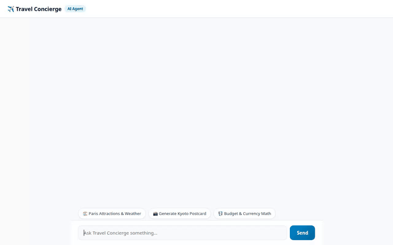

# ✈️ Travel Concierge

A conversational AI travel assistant built with the **Google Agent Development Kit (ADK)** and deployed on **Vertex AI Agent Runtime**. Travel Concierge helps users explore destinations, calculate travel budgets, search nearby attractions, generate photorealistic travel postcards and destination video clips, check live weather, and remember user preferences & dietary allergies across sessions.



---

## 🌟 Key Features & Capabilities

### 🧠 Persistent Long-Term Memory & Allergy Guardrails
* **Vertex AI Memory Bank**: Persists user facts, budget preferences, past travel destinations, and dietary/allergy constraints across conversation turns and sessions using `PreloadMemoryTool` and an automated memory generation callback.
* **Allergy Safety Guardrails**: Retains food allergies (e.g., peanuts, shellfish, gluten) and alerts users when recommending local dining or food tours.

### 🎨 Rich A2UI Interface Components
* **A2UI Schema Manager (v0.8)**: Generates structured, responsive UI cards (`Card`, `Column`, `Row`, `Text`, `Image`) in place of raw text responses.
* **Contextual Action Chips**: Dynamically generates follow-up prompt chips (*Check Weather*, *Generate Postcard*, *Trip Budget Math*) based on mentioned destination cities.

### 🖼️ Multimodal Generation & Cloud Storage
* **AI Postcard Image Generation**: Generates high-quality destination postcard images using **`gemini-3.1-flash-lite-image`** (global region).
* **AI Destination Video Generation**: Generates short scenic travel videos using **`gemini-omni-flash-preview`** via Vertex AI Interactions REST API.
* **Public Cloud Storage**: Saves media as local artifacts and uploads raw image/video bytes directly to a public Google Cloud Storage bucket (`storage.googleapis.com`), returning accessible HTTPS image/video URLs.

### 🛠️ Google Cloud & External Tools
1. **`list_destinations`**: Queries Firestore database for destination spots filtered by travel categories (*Culture & Food*, *Romance & Art*, *Nature & Adventure*).
2. **`get_destination_details`**: Fetches destination metadata from Google Cloud Firestore.
3. **`add_destination`**: Adds new travel spots directly into the Firestore collection.
4. **`calculate_trip_budget`**: Calculates itemized travel expenses (accommodation, food, transport, activities).
5. **`search_attractions_by_interest`**: Filters destination activities based on user interest tags (*temples*, *museums*, *nightlife*, *hiking*).
6. **`get_currency_exchange_rate`**: Fetches real-time currency conversion rates via REST API.
7. **`geocode_address`**: Resolves geographic coordinates using Google Maps Geocoding API.
8. **`find_nearby_places`**: Discovers nearby places, restaurants, and attractions using Google Places API (New).
9. **`get_weather`**: Retrieves real-time weather and forecasts for any global destination.
10. **`get_current_time`**: Returns localized time for specific timezones.
11. **`code_executor`**: Executes custom Python code and expense calculations inside Google Cloud's secure `AgentEngineSandboxCodeExecutor`.

> **Note on Planned Features**: Live flight & hotel booking engine API integrations were planned in the original brief but are *planned / not yet implemented*.

---

## 🏗️ Architecture & Stack

* **Framework**: Google Agent Development Kit (ADK) `v1.1.0`
* **Foundation Model**: `gemini-flash-latest` (Reasoning Engine) + `gemini-omni-flash-preview` (Video) + `gemini-3.1-flash-lite-image` (Image)
* **Database**: Google Cloud Firestore
* **Storage**: Google Cloud Storage (Public Bucket)
* **Memory**: Vertex AI Memory Bank (`VertexAiMemoryBankService`)
* **Execution Sandbox**: Vertex AI Agent Engine Code Executor
* **Frontend**: FastAPI proxy server with custom HTML5/CSS3 glassmorphism dialogue interface + A2UI renderer shipped to Cloud Run

---

## 🚀 Setup & Local Execution

### 1. Prerequisites
Ensure Python `3.10+` and `uv` or `pip` are installed.

```bash
# Clone repository and navigate to directory
cd travel-concierge

# Install dependencies
uv sync
```

### 2. Environment Variables
Create a `.env` file in the project root:

```env
GOOGLE_CLOUD_PROJECT=your-gcp-project-id
GOOGLE_CLOUD_LOCATION=us-east1
GOOGLE_MAPS_API_KEY=your-google-maps-api-key
```

### 3. Run Locally

#### Start the Agent & Web Frontend Proxy:
```bash
AGENT_ENGINE_RESOURCE_NAME="projects/YOUR_PROJECT/locations/us-east1/reasoningEngines/YOUR_ENGINE_ID" \
AGENT_DIRECTORY="app" \
PORT=8080 \
uv run python main.py
```
Open a browser and navigate to the local port (e.g. port `8080`) to interact with the Travel Concierge assistant.

#### Test Agent via CLI:
```bash
agents-cli run app
```

---

## ☁️ Deployment

### Deploy Agent to Vertex AI Agent Runtime:
```bash
agents-cli deploy \
  --project=YOUR_PROJECT_ID \
  --region=us-east1 \
  --update-env-vars GOOGLE_MAPS_API_KEY=YOUR_KEY
```

### Deploy Frontend Proxy to Cloud Run:
```bash
gcloud run deploy travel-concierge-frontend \
  --source . \
  --region us-east1 \
  --allow-unauthenticated \
  --set-env-vars="AGENT_ENGINE_RESOURCE_NAME=YOUR_REASONING_ENGINE_PATH,AGENT_DIRECTORY=app"
```
